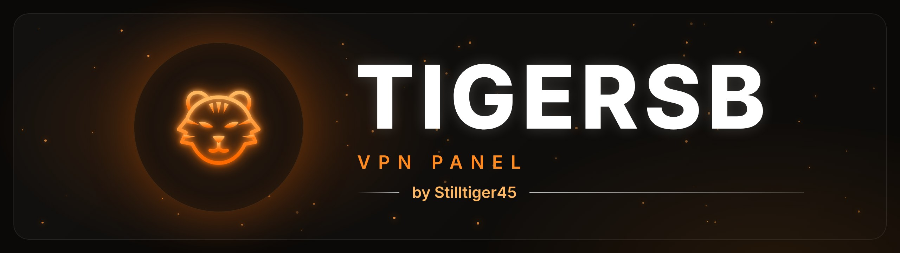
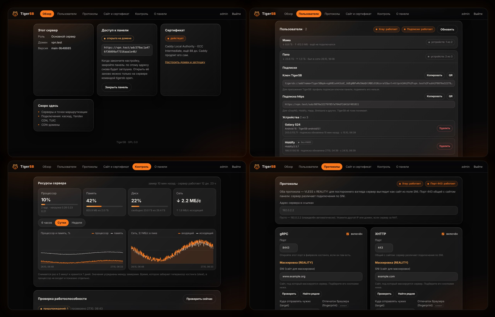

<p align="center">
  
</p>

<p align="center">
  <a href="LICENSE"></a>
  <a href="https://github.com/Stilltiger45/TigerSB-panel/actions/workflows/ci.yml"></a>
  
</p>

<p align="center">
  <a href="https://github.com/XTLS/Xray-core"></a>
  <a href="https://github.com/SagerNet/sing-box"></a>
  <a href="https://caddyserver.com"></a>
  
</p>

<p align="center">
  
  
  
</p>

<p align="center">
  <a href="README.ru.md">🇷🇺 Русский</a> &nbsp;|&nbsp; 🇬🇧 <b>English</b>
</p>

---

**TigerSB-panel** is your own VPN on your own server. Rent a VPS, run one command, and a couple of minutes later you have a web panel: add a person, send them a key or a QR code, and they are connected. From the outside the server looks like an ordinary website under maintenance.

It is made for the [TigerSB](https://github.com/Stilltiger45/TigerSB-client) app, and its plain `https://` subscriptions work in v2rayNG, Hiddify, Happ, Streisand and other Xray and sing-box clients.

<p align="center">
  
</p>

<sub>Screenshots from a test server. The panel interface is in Russian.</sub>

**Contents:** [For users](#for-users) · [For developers](#for-developers)

# For users

## What it does

- **Installs with one command** and gets a certificate for your domain by itself. Running it again breaks nothing.
- **Stays hidden.** The panel opens only on a secret address; every other address shows a harmless "Maintenance" page. «Закрыть панель» (Close panel) hides the secret address too, and only SSH can open it again.
- **A user in two clicks:** a name and a device count. Each user gets a `tigersb://` key and an `https://` subscription, both with a QR code.
- **Device limit.** Extra phones and computers get no subscription, and any device can be removed with a button.
- **Six protocols:** VLESS + REALITY over XHTTP and gRPC, TUIC, Hysteria 2, NaïveProxy and Mieru. Everything is set up from the start; changing anything is optional. Each protocol can get its own test link to check it alone.
- **Watches the server:** load charts and health checks with a hint on what to do when something is wrong.
- **Updates with a button** and rolls back by itself if the new version does not start.

Coming next: a cascade through a routing point in Russia (gRPC and TUIC), XHTTP through Yandex Cloud CDN.

## Quick start

**1. What you need.** A clean VPS with Debian 11+ or Ubuntu 20.04+ (amd64 or arm64), a domain with an A record pointing to the server's IP, and root access.

**2. Install.** Connect to the server over SSH and run:

```bash
curl -fsSL https://raw.githubusercontent.com/Stilltiger45/TigerSB-panel/main/scripts/install.sh | sudo bash
```

The installer asks for the server role (pick "main server"; the "routing point" is for the upcoming cascade), the domain with an email for the certificate, and the admin login and password (at least 10 characters). At the end it prints the panel address, `https://<domain>/<secret path>/`. Keep it; `tigersb info` on the server shows it again.

If your hosting has its own firewall, open ports 443 and 8443 for TCP and UDP there.

**3. Add a person.** Open the panel address, log in, add a person on the **Пользователи** (Users) tab and click them: the TigerSB key and the https subscription appear with QR codes.

**4. Connect a device.** Download [TigerSB for Android](https://github.com/Stilltiger45/TigerSB-client/releases/latest/download/TigerSB-android.apk), open the `tigersb://` key on the phone (or scan the QR code, or paste the key into the app) and press the connect button. In v2rayNG, Hiddify and others, add the https link as a subscription.

**5. Hide the panel.** When you are done, press «Закрыть панель» (Close panel) on the Overview tab. To open it again, run `tigersb open` over SSH.

Every tab in detail: the [panel guide](docs/guide.md) (in Russian).

## Update and uninstall

Update: the «Обновить панель» (Update panel) button on the Контроль (Control) tab, or `tigersb update` on the server. Users and settings are kept, and the VPN keeps working during the update.

Remove everything (asks for confirmation and offers to save a copy of the settings and database):

```bash
curl -fsSL https://raw.githubusercontent.com/Stilltiger45/TigerSB-panel/main/scripts/uninstall.sh | sudo bash
```

<details>
<summary><b>Server commands</b></summary>

| Command | What it does |
|---|---|
| `tigersb info` | show the panel address and the fallback SSH tunnel command |
| `tigersb open` | open the panel at `https://<domain>/<secret path>/` |
| `tigersb close` | hide the panel: the secret path shows the maintenance page again |
| `tigersb site status` | domain, page template, Caddy and certificate state |
| `tigersb site set --domain <domain> [--email <email>]` | change the domain from the console if the panel is unreachable |
| `tigersb site apply` | rewrite the maintenance page and Caddy settings and apply them |
| `tigersb passwd --admin <login>` | change the password and end all sessions |
| `tigersb sleep` | put the panel to sleep: the process stops and the secret path shows the maintenance page. VPN and subscriptions keep working |
| `tigersb wake` | wake the panel |
| `tigersb status` | panel state |
| `tigersb update` | update from GitHub: restore point, update, rollback on failure |
| `tigersb restore list` | list restore points |
| `tigersb restore create` | create a restore point |
| `tigersb restore apply <name>` | roll back to a restore point |
| `tigersb xray status` | Xray and port 443 state, protocols and user count |
| `tigersb xray apply` | rebuild the Xray config from the database, test it and restart |
| `tigersb singbox status` | sing-box state, the TUIC, Hysteria 2, NaïveProxy and Mieru ports |
| `tigersb singbox apply` | rebuild the sing-box config and certificate copy, test them and restart |
| `tigersb mieru apply` | the same for the Mieru (mbox) container |
| `tigersb monitor` | take metrics and run health checks now (a timer does this every 5 minutes) |

</details>

# For developers

## Components

| Component | Role | License |
|---|---|---|
| [Xray-core](https://github.com/XTLS/Xray-core) 26.9.30 | VPN core: VLESS + REALITY, XHTTP, gRPC. Official image in Docker, pinned by digest | MPL-2.0 |
| [sing-box](https://github.com/SagerNet/sing-box) 1.14.4 | second VPN core: TUIC v5, Hysteria 2 and NaïveProxy. Official image in Docker, pinned by digest | GPL-3.0-or-later |
| [mbox](https://github.com/enfein/mbox) 1.14.3 | sing-box build by the Mieru author, third core for Mieru. Release binary checked by sha256, runs in the sing-box image | GPL-3.0-or-later |
| [Caddy](https://caddyserver.com) 2.11.4 | maintenance site, Let's Encrypt certificate, panel and subscription routes | Apache-2.0 |
| [Docker](https://www.docker.com) | runs Xray, sing-box and mbox without privileges on a read-only file system | Apache-2.0 |
| [Go](https://go.dev) 1.26 | the panel, the port 443 splitter, the subscription service, metrics | BSD-3-Clause |
| [SQLite](https://sqlite.org) (modernc, no cgo) | users, devices, settings, charts | BSD-3-Clause |
| [pkg/profile](https://github.com/Stilltiger45/TigerSB-client/tree/main/pkg/profile) from TigerSB-client | TigerSB profile format and signature | GPL-3.0 |

## How it works

- **One Go binary, `tigersb`,** and several `tigersb-*` systemd services: the web panel, the port 443 splitter, subscriptions, Caddy, Xray, sing-box, Mieru, the health check timer and the updater. All data lives in SQLite under `/var/lib/tigersb`.
- **Port 443 is shared.** The `tigersb-edge` service reads the SNI and hands the connection either to Caddy (site, panel, subscriptions) or to the matching Xray protocol. Hysteria 2 takes UDP 443, TUIC takes UDP 8443, NaïveProxy takes TCP 2443, Mieru takes TCP 2012–2022.
- **The panel writes the configs**, has the core itself check them, and only then applies them. Users are added to Xray through its API without a restart.
- **Subscriptions** come from a separate `tigersb-sub` service, so they keep working while the panel is closed or asleep. The TigerSB app gets a signed profile, other clients get a list of `vless://` links.
- **Updates** run in a separate service outside the panel: restore point, install, check, rollback on failure.

Details: [architecture](docs/architecture.md) (in Russian), [profile and key format](https://github.com/Stilltiger45/TigerSB-client/blob/main/docs/profile.md).

## Security

- **Hidden panel.** It listens on `127.0.0.1` only, and Caddy publishes it on a secret path. `tigersb close` and `tigersb sleep` hide that path too, and only `tigersb open` over SSH brings it back. An SSH tunnel is the fallback way in.
- **Login.** Passwords are stored as Argon2id, sessions as a SHA-256 of the token. Cookies are `HttpOnly`, `SameSite=Strict`, limited to the secret path (and `Secure` when logging in through the domain); a session lasts 12 hours. Five failed attempts lock a login for 15 minutes, and 30 in total lock the whole login. Changes are accepted only as same-origin JSON, and pages are served with a CSP and `X-Frame-Options`.
- **Signed profile.** The panel creates an Ed25519 key once and signs every profile with it. The public key is part of the `tigersb://` key, and the client accepts only a profile with that signature, so nobody on the way can swap the servers.
- **Invisible subscriptions.** A wrong token, a disabled user or a service that is down all return the same maintenance page with the same headers as any other page of the site. Responses are not cached, and the `Server` and `Via` headers are removed.
- **HWID device limit.** The client sends `x-hwid` and device details, and a new device over the limit gets no subscription. The device IP comes from the PROXY header set by the port 443 service, so `X-Forwarded-For` cannot fake it.
- **Isolated cores.** Xray, sing-box and mbox run from official images pinned by digest, without privileges (`--cap-drop ALL`), on a read-only file system and with no logs, so no user addresses are left on disk.
- **Verified downloads.** Caddy is a pinned version checked against its SHA-512. The certificate is issued over TLS-ALPN, and port 80 stays closed.

To report a vulnerability privately, see [SECURITY.md](SECURITY.md).

## Build and test

```bash
go test ./...
CGO_ENABLED=0 go build -o tigersb ./cmd/tigersb
```

Installing from a clone builds the panel from the working copy:

```bash
git clone https://github.com/Stilltiger45/TigerSB-panel.git
cd TigerSB-panel
sudo ./scripts/install.sh            # or --binary ./tigersb-linux-amd64 with a ready binary
```

CI runs `gofmt`, `go vet`, the tests with `-race`, `shellcheck` on the scripts and a dependency license check. A `v*` tag builds a release with `tigersb-linux-amd64` and `tigersb-linux-arm64`.

## Licenses

The panel is **GPL-3.0**, see [LICENSE](LICENSE). It matches the license of [TigerSB-client](https://github.com/Stilltiger45/TigerSB-client), so the panel can use its `pkg/profile` package.

- **Go dependencies** are MIT or BSD only, all compatible with GPL-3.0. `scripts/check-licenses.sh` fails CI when a dependency has no license or an incompatible one (AGPL, SSPL, BSL and similar).
- **Programs next to the panel** (Xray MPL-2.0, sing-box and mbox GPL-3.0, Caddy Apache-2.0, Docker Apache-2.0) are installed from official builds without changes and run as separate programs. No sing-box or mbox code is in the panel; the panel only writes its config.
- **Borrowed ideas.** From [web-panel-proxy](https://github.com/POLESNIESOVETI12/web-panel-proxy) (MIT): TLS-ALPN-only certificates, a pinned Caddy and the update flow with a restore point; from [OlConnect_manager](https://github.com/Oleglog/OlConnect_manager) (WTFPL): one-command install and uninstall; from [RealiTLScanner](https://github.com/XTLS/RealiTLScanner) (MPL-2.0): the SNI scanner. No code from these projects was copied; everything is written anew in Go.

The full list with versions is in [THIRD_PARTY_NOTICES.md](THIRD_PARTY_NOTICES.md) and on the «О панели» (About) tab.
